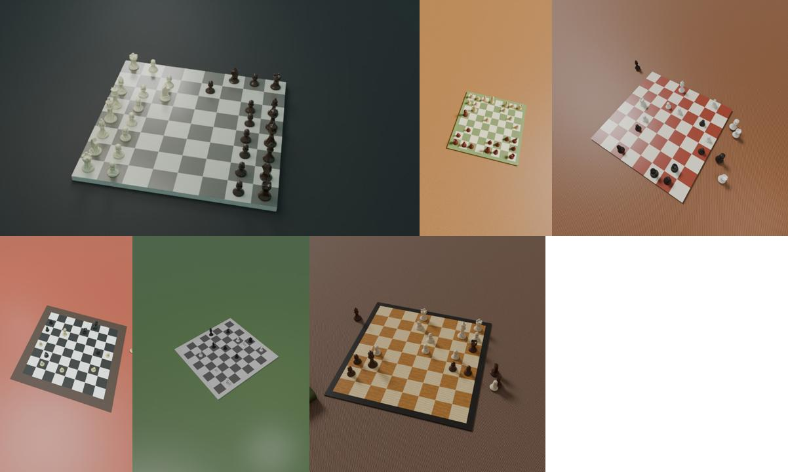

# chess-board-renderer

Renders labelled photos of chess boards with Blender, as training data for a
board reader (photo → position), such as open-chess's `chess-vision-train`.



Every render is made from scratch:

- **Pieces** are Staunton-style, modelled in `render.py` from profiles. Each
  design varies in proportions.
- **Boards** come in wood, tournament green, black and white, blue, grey,
  and cream and red, with or without a border.
- **Tables, lighting and clutter** vary too: one to three lights, warm or
  cool, with soft or hard shadows. Captured pieces sometimes stand beside
  the board.
- **Camera views** cover any side of the board, low to overhead, 22–55 mm
  lenses, phone aspect ratios, a slight roll, and now and then a shallow
  depth of field.

No outside models, textures or photos go in. Positions come from random games
or from the Lichess open database (CC0). So the images are **yours to
license**, and a model trained on them can ship.

## Use

You need [Blender](https://www.blender.org/download/). It was tested with 5.0.
You also need Python with `python-chess` for the positions.

```sh
pip install chess            # and zstandard, to read .pgn.zst
# 1. Positions: random games, and/or real ones from https://database.lichess.org
python positions.py --random 3000 --out positions.txt
python positions.py --random 1000 --pgn lichess_db_standard_rated_2013-01.pgn.zst \
    --from-pgn 4000 --out positions.txt

# 2. Photos (on a Mac, Blender renders on the GPU with Metal)
blender -b -P render.py -- --positions positions.txt --out ~/chess-data/synthetic --count 10000
```

Instead of the Blender app, you can use Blender as a Python module:
`pip install bpy` (Python 3.11), then `python render.py --positions … --out …`.

The output is `photos/000000.jpg …` plus `labels.jsonl`, in the trainer's
`jsonl` format:

```json
{"image": "photos/000000.jpg", "placement": "rnbqkbnr/pppppppp/8/8/4P3/8/PPPP1PPP/RNBQKBNR", "group": "pos-000000"}
```

- **Labels are from White's side** (a1 first), whichever side the camera is
  on.
- **Views of one position share a `group`**, so the trainer never splits them
  between training and validation.
- **A stopped run carries on** when started again. Raise `--count` to add
  more photos to the same folder.

For open-chess, add the folder to `crates/chess-vision-train/datasets.toml`:

```toml
[dataset.synthetic]
# Rendered by chess-board-renderer: models, scenes and positions our own
# (random games, or Lichess's CC0 database).
licence = "LicenseRef-esl-internal"
licence_verified = true
verified_by = "…"
verified_on = "…"
format = "jsonl"
path = "synthetic"
```

## Open datasets to mix in

`import_datasets.py` turns openly licensed board datasets into the same
format: samryan18's 500 photos (MIT), the chesscog renders (CC BY 4.0) and
the robot-chess-commentator boards (CC BY 4.0). See [DATASETS.md](DATASETS.md)
for where to get them, their licences and attribution lines.

## Options

| Option | Default | |
|---|---|---|
| `--positions FILE` | | FEN placements, one per line (`positions.py`) |
| `--out DIR` | | Where `photos/` and `labels.jsonl` go |
| `--count N` | `100` | Photos in `--out` when done |
| `--views N` | `3` | Photos of each position, each in a new scene from a new angle |
| `--size N` | `1024` | Long side in pixels. The trainer scales to 392–644, so 768–1024 is plenty |
| `--samples N` | `32` | Cycles samples, denoised. 16 is fine for training and twice as fast |
| `--style-every N` | `25` | A new piece design every N photos |
| `--seed N` | `0` | |
| `--cpu` | | Don't look for a GPU |

`positions.py` options:

| Option | Default | |
|---|---|---|
| `--random N` | | Positions from random games |
| `--pgn FILE` | | A PGN file (`.pgn` or `.pgn.zst`) to sample from |
| `--from-pgn N` | | How many positions to take from `--pgn` |
| `--per-game N` | `3` | At most N positions per game |
| `--start N` | | Add N copies of the starting position |
| `--out FILE` | | Where the positions go |

## Speed

A 512-pixel photo with 12 samples took about 5 seconds on two CPU cores. A
Mac's GPU is much faster. Run a `--count 20` test first to see the time per
photo: the run prints it, along with the time left.

## Limits, and what to add

- No hands, motion blur or photo noise. The trainer's augmentation adds
  light, focus and JPEG changes.
- One piece family, Staunton. The knight is a simple carved silhouette.
  Real photos are still needed to bridge the gap: use these for bulk, then
  your own photos on top. The trainer's `--teacher` can carry a model trained
  on both into the phone-sized one.
- Further ideas: other piece families, glass and metal sets, board
  coordinates printed on the border, people and hands at the edge of the
  frame, and outdoor scenes.

## Licence

The code is MIT OR Apache-2.0. Photos you render are yours.
